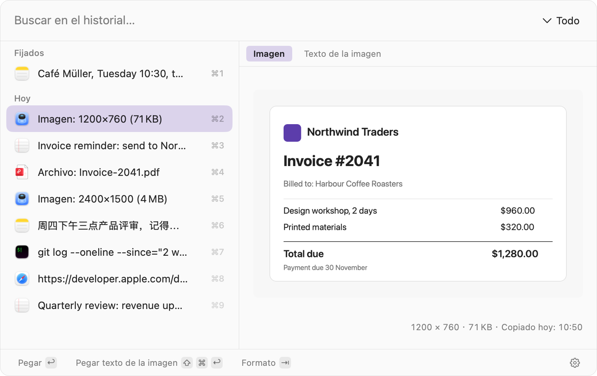
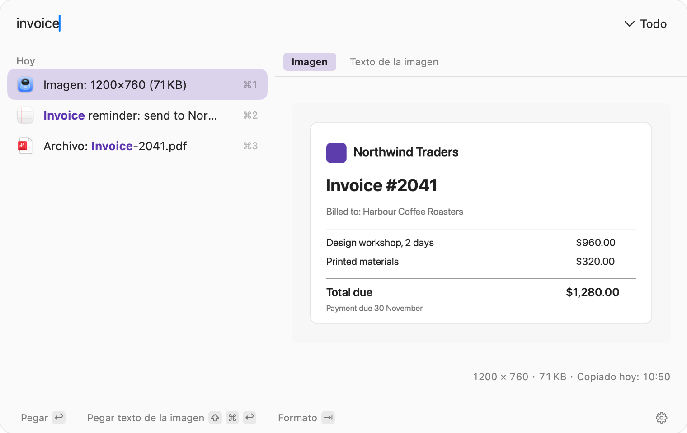
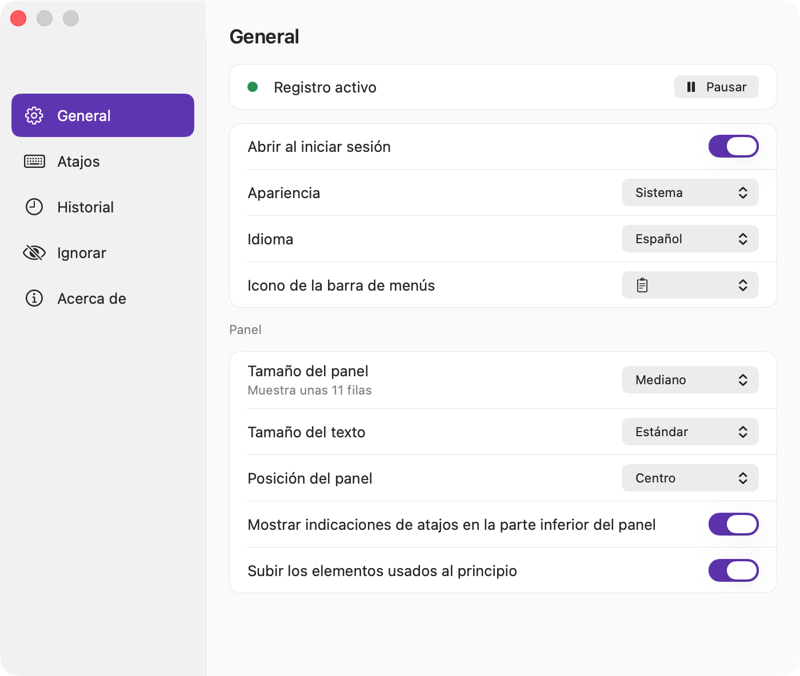

<p align="center">
  
</p>

<h1 align="center">Bowerbird</h1>

<p align="center">
  Historial del portapapeles para macOS, en la barra de menús. Guarda texto, imágenes y archivos, los pega con una pulsación y nunca se conecta a la red.
</p>

<p align="center">
  <a href="README.md">English</a> | <a href="README.zh-CN.md">简体中文</a> | <a href="README.zh-TW.md">繁體中文</a> | <a href="README.ja.md">日本語</a> | <strong>Español</strong> | <a href="README.fr.md">Français</a> | <a href="README.ru.md">Русский</a>
</p>

Los pergoleros (bowerbirds) recogen objetos brillantes y los colocan con cuidado; este recoge lo que copias.



## Instalación

1. Descarga el `.dmg` de la [última versión](https://github.com/terryxc/bowerbird/releases/latest) y arrastra Bowerbird a Aplicaciones.
2. Ábrela una vez. La app usa un certificado autofirmado, sin firma Developer ID ni notarización de Apple. Si macOS la bloquea, permite su apertura aquí:

   ```
   Ajustes del Sistema → Privacidad y seguridad → Abrir igualmente
   ```

   O evita el aviso ejecutando esto en Terminal:

   ```sh
   xattr -d com.apple.quarantine /Applications/Bowerbird.app
   ```

Requiere macOS 14 o posterior. Funciona en Mac con Apple silicon e Intel.

## Uso

- Pulsa ⇧⌘V, escribe para filtrar y pulsa Retorno para pegar.
- Conserva texto con formato, HTML, imágenes, PDF y referencias a archivos. ⇧⌘Retorno pega como texto sin formato. En un archivo, ⇥ cambia a su ruta; en una captura con texto reconocido, a ese texto. Solo se guarda la ruta de los archivos, por lo que los originales deben seguir accesibles.
- Con el reconocimiento de texto activado, las capturas se pueden buscar por el texto reconocido mediante OCR en el propio Mac. Haz la captura con ⌃⇧⌘4 de macOS para que vaya al portapapeles y no al escritorio.
- La búsqueda no distingue entre mayúsculas y minúsculas, acentos ni variantes de ancho de los caracteres. Si no hay coincidencias exactas, admite algunas erratas en consultas de 4–64 caracteres ASCII tras la normalización. El menú a la derecha del campo de búsqueda limita la lista a texto, imágenes o archivos.
- ⌘P fija un elemento en la parte superior del historial y evita que se elimine automáticamente al vencer el plazo de conservación.
- ⌘1–9 pega esa fila, ⌘Retorno copia sin pegar, ⌘⌫ elimina. Estos son los atajos predeterminados. Puedes cambiar el atajo para abrir el panel y los de sus acciones en Ajustes → Atajos; ⌘1–9, las teclas de navegación y Esc son fijos.



En Ajustes también se elige si se abre al iniciar sesión, la apariencia, el idioma y el tamaño y la posición del panel.



## Privacidad

- Sin red.
- Un solo permiso: Accesibilidad, para pulsar ⌘V por ti. Es opcional; sin él, copia desde Bowerbird y pega manualmente.
- Se omite el contenido que la app de origen marca como sensible. De forma predeterminada se ignoran 1Password, Bitwarden y Acceso a Llaveros. Gestiona las apps excluidas y los patrones de contenido en Ajustes → Ignorar; el contenido sensible sin marcar de otras apps puede quedar registrado.
- Por omisión, el texto y los archivos se conservan 30 días y las imágenes 7. Se cambia en Ajustes → Historial.
- Los datos están en `~/Library/Application Support/Bowerbird/`.

## Preguntas frecuentes

Consulta [docs/faq.es.md](docs/faq.es.md).

## Compilar desde el código

Necesita la versión completa de Xcode 26 o posterior, seleccionada como directorio de desarrollo activo. El empaquetado usa `actool` para compilar los recursos del icono y las pruebas requieren XCTest; las Command Line Tools solas no bastan. La imagen de disco necesita además [dmgbuild](https://github.com/dmgbuild/dmgbuild), que abajo se instala con [uv](https://docs.astral.sh/uv/).

```sh
./scripts/make-cert.sh          # una vez: certificado local, para que Accesibilidad sobreviva a las recompilaciones
./scripts/build-app.sh release  # → build/Bowerbird.app
swift test

uv tool install dmgbuild        # una vez, solo para crear la imagen de disco
./scripts/make-dmg.sh           # → build/Bowerbird-<version>.dmg
```

| Ruta | Contenido |
| --- | --- |
| `Sources/BowerbirdCore/` | Almacenamiento, lectura del portapapeles, OCR. Sin interfaz. |
| `Sources/Bowerbird/` | Barra de menús, panel, pegado, ajustes. |
| `Support/` | `Info.plist`, iconos, un `.lproj` por idioma. |
| `scripts/` | Certificado, generación del icono, compilación, dmg. |
| `docs/` | Preguntas frecuentes, logotipo, capturas. |

Dependencias: [GRDB.swift](https://github.com/groue/GRDB.swift) y [KeyboardShortcuts](https://github.com/sindresorhus/KeyboardShortcuts), ambas con licencia MIT.

Avisos de licencias de terceros: [THIRD_PARTY_NOTICES.md](THIRD_PARTY_NOTICES.md).

## Licencia

MIT. Consulta [LICENSE](LICENSE).
