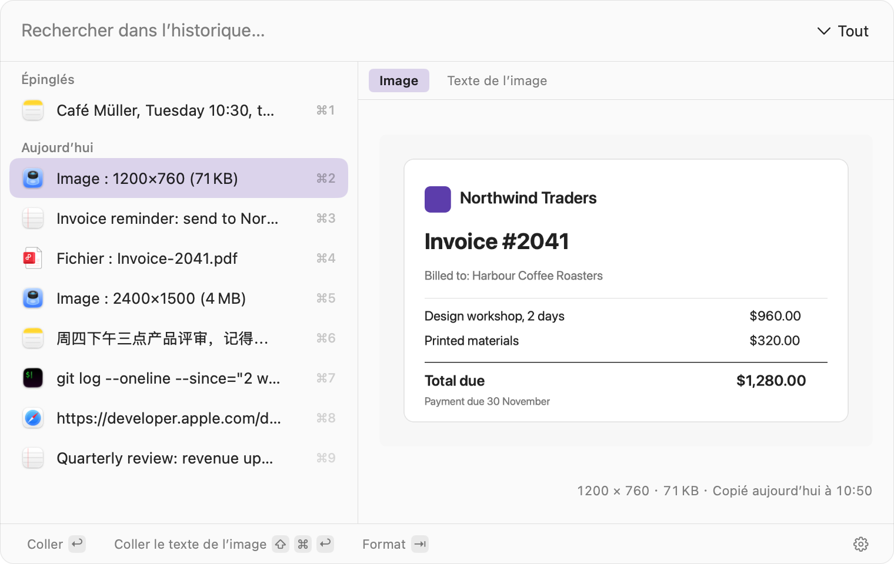
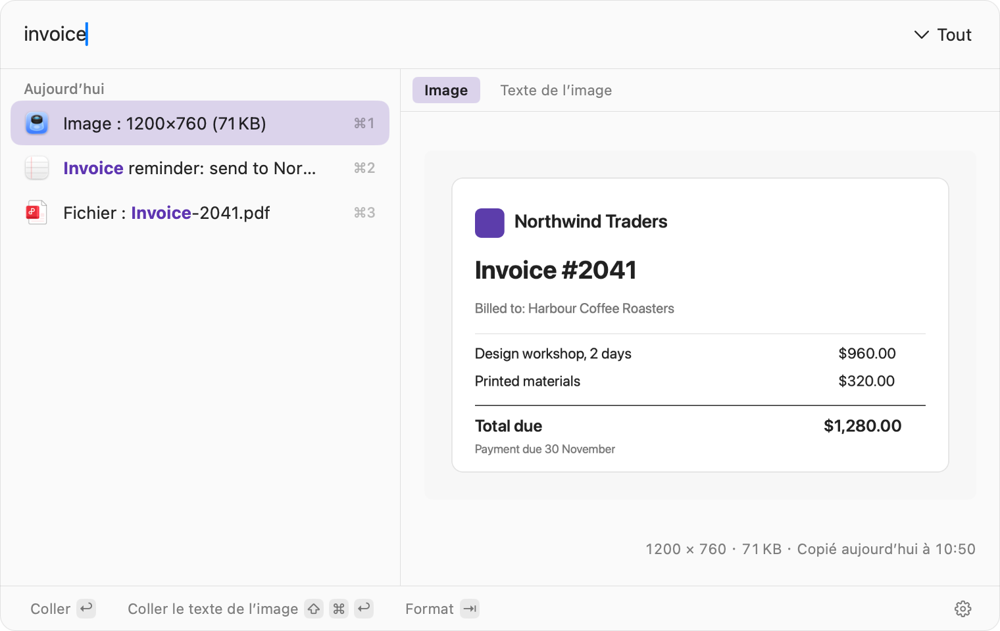
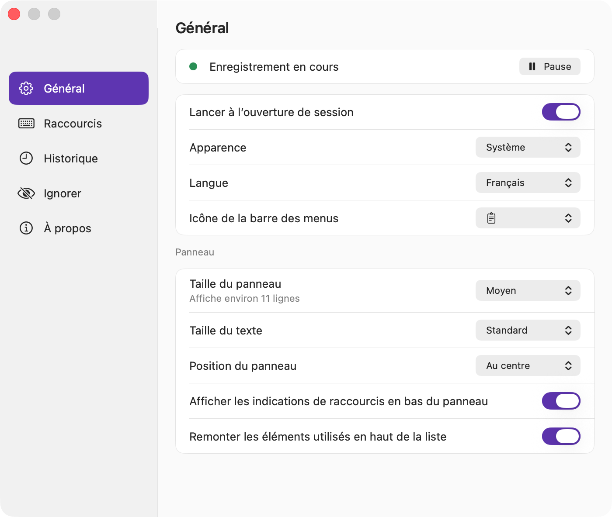

<p align="center">
  
</p>

<h1 align="center">Bowerbird</h1>

<p align="center">
  Historique du presse-papiers pour macOS, dans la barre des menus. Il conserve le texte, les images et les fichiers, les recolle d’une touche et ne se connecte jamais au réseau.
</p>

<p align="center">
  <a href="README.md">English</a> | <a href="README.zh-CN.md">简体中文</a> | <a href="README.zh-TW.md">繁體中文</a> | <a href="README.ja.md">日本語</a> | <a href="README.es.md">Español</a> | <strong>Français</strong> | <a href="README.ru.md">Русский</a>
</p>

Les oiseaux jardiniers (bowerbirds) ramassent des objets brillants et les disposent avec soin ; celui-ci ramasse ce que vous copiez.



## Installation

1. Téléchargez le `.dmg` depuis la [dernière version](https://github.com/terryxc/bowerbird/releases/latest) et glissez Bowerbird dans Applications.
2. Ouvrez-la une fois. L’app utilise un certificat autosigné, sans signature Developer ID ni notarisation Apple. Si macOS la bloque, autorisez son ouverture ici :

   ```
   Réglages Système → Confidentialité et sécurité → Ouvrir quand même
   ```

   Ou évitez le blocage en exécutant ceci dans Terminal :

   ```sh
   xattr -d com.apple.quarantine /Applications/Bowerbird.app
   ```

Nécessite macOS 14 ou ultérieur. Fonctionne sur les Mac Apple silicon et Intel.

## Utilisation

- Appuyez sur ⇧⌘V, tapez pour filtrer, appuyez sur Retour pour coller.
- Conserve le texte enrichi, le HTML, les images, les PDF et les références aux fichiers. ⇧⌘Retour colle en texte brut. Pour un fichier, ⇥ passe à son chemin ; pour une capture dont le texte a été reconnu, à ce texte. Seul le chemin des fichiers est enregistré : les originaux doivent rester accessibles.
- Lorsque la reconnaissance de texte est activée, les captures d’écran se retrouvent par le texte reconnu sur le Mac. Prenez-les avec ⌃⇧⌘4 de macOS pour qu’elles aillent dans le presse-papiers plutôt que sur le bureau.
- La recherche ignore les différences de casse, d’accent et de largeur des caractères. Sans correspondance exacte, elle tolère certaines fautes de frappe pour les requêtes de 4 à 64 caractères ASCII après normalisation. Le menu à droite du champ de recherche limite la liste au texte, aux images ou aux fichiers.
- ⌘P épingle un élément en haut de l’historique et le protège de la suppression automatique à l’expiration du délai de conservation.
- ⌘1–9 colle cette ligne, ⌘Retour copie sans coller, ⌘⌫ supprime. Ce sont les raccourcis par défaut. Modifiez le raccourci d’ouverture du panneau et ceux de ses actions dans Réglages → Raccourcis ; ⌘1–9, les touches de navigation et Esc restent fixes.



Les Réglages permettent aussi de choisir l’ouverture à la connexion, l’apparence, la langue, ainsi que la taille et la position du panneau.



## Confidentialité

- Aucun accès au réseau.
- Une seule autorisation : Accessibilité, pour appuyer sur ⌘V à votre place. Facultative ; sans elle, copiez depuis Bowerbird puis collez manuellement.
- Le contenu signalé comme sensible par l’app source est ignoré. Par défaut, 1Password, Bitwarden et Trousseaux d’accès sont exclus. Gérez les apps exclues et les motifs de contenu dans Réglages → Ignorer ; le contenu sensible non signalé provenant d’autres apps peut être enregistré.
- Par défaut, le texte et les fichiers sont conservés 30 jours, les images 7 jours. Cela se règle dans Réglages → Historique.
- Les données sont dans `~/Library/Application Support/Bowerbird/`.

## Questions fréquentes

Voir [docs/faq.fr.md](docs/faq.fr.md).

## Compiler depuis les sources

La version complète de Xcode 26 ou ultérieur doit être installée et sélectionnée comme répertoire de développement actif. La création du paquet utilise `actool` pour compiler les ressources de l’icône, et les tests nécessitent XCTest ; les Command Line Tools seuls ne suffisent pas. L’image disque demande en plus [dmgbuild](https://github.com/dmgbuild/dmgbuild), installé ci-dessous avec [uv](https://docs.astral.sh/uv/).

```sh
./scripts/make-cert.sh          # une fois : certificat local, pour que l’autorisation Accessibilité survive aux recompilations
./scripts/build-app.sh release  # → build/Bowerbird.app
swift test

uv tool install dmgbuild        # une fois, seulement pour l’image disque
./scripts/make-dmg.sh           # → build/Bowerbird-<version>.dmg
```

| Chemin | Contenu |
| --- | --- |
| `Sources/BowerbirdCore/` | Stockage, lecture du presse-papiers, OCR. Sans interface. |
| `Sources/Bowerbird/` | Barre des menus, panneau, collage, réglages. |
| `Support/` | `Info.plist`, icônes, un `.lproj` par langue. |
| `scripts/` | Certificat, génération de l’icône, compilation, dmg. |
| `docs/` | FAQ, logo, captures d’écran. |

Dépendances : [GRDB.swift](https://github.com/groue/GRDB.swift) et [KeyboardShortcuts](https://github.com/sindresorhus/KeyboardShortcuts), toutes deux sous licence MIT.

Mentions des licences tierces : [THIRD_PARTY_NOTICES.md](THIRD_PARTY_NOTICES.md).

## Licence

MIT. Voir [LICENSE](LICENSE).
