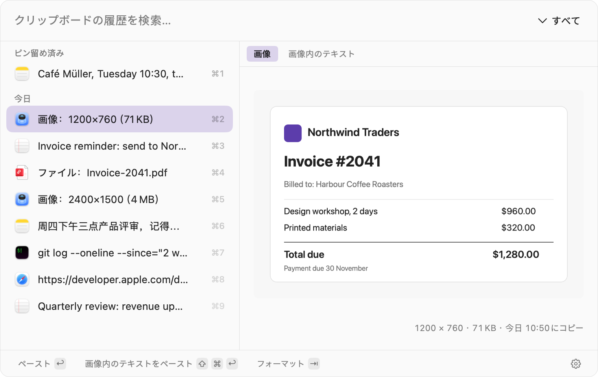
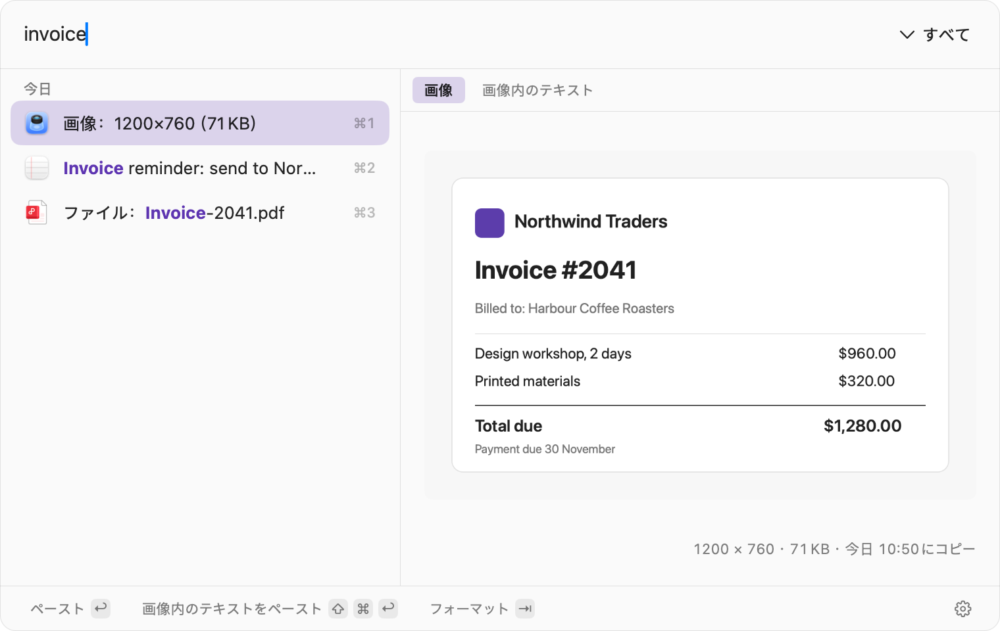
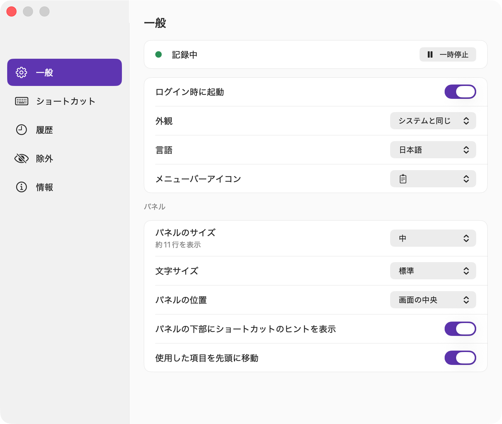

<p align="center">
  
</p>

<h1 align="center">Bowerbird</h1>

<p align="center">
  メニューバーに常駐する macOS 用クリップボード履歴アプリ。テキスト、画像、ファイルを記録し、キー操作ひとつでペーストします。ネットワークには一切接続しません。
</p>

<p align="center">
  <a href="README.md">English</a> | <a href="README.zh-CN.md">简体中文</a> | <a href="README.zh-TW.md">繁體中文</a> | <strong>日本語</strong> | <a href="README.es.md">Español</a> | <a href="README.fr.md">Français</a> | <a href="README.ru.md">Русский</a>
</p>

ニワシドリ（bowerbird）は光るものを集めて丁寧に並べる鳥です。このアプリが集めるのは、あなたがコピーしたものです。



## インストール

1. [最新のリリース](https://github.com/terryxc/bowerbird/releases/latest)から `.dmg` をダウンロードし、Bowerbird を「アプリケーション」にドラッグします。
2. 一度開いてください。アプリは自己署名証明書を使用しており、Developer ID 署名も Apple の公証もありません。macOS にブロックされた場合は、ここで許可します：

   ```
   システム設定 → プライバシーとセキュリティ → このまま開く
   ```

   または、ターミナルで次を実行すればブロックされません：

   ```sh
   xattr -d com.apple.quarantine /Applications/Bowerbird.app
   ```

macOS 14 以降が必要です。Apple シリコンと Intel の Mac に対応しています。

## 使い方

- ⇧⌘V を押し、入力して絞り込み、Return でペースト。
- リッチテキスト、HTML、画像、PDF、ファイルへの参照を保持します。⇧⌘Return で標準テキストとしてペースト。ファイルでは ⇥ でパスに、文字認識済みのスクリーンショットでは認識されたテキストに切り替わります。ファイルはパスのみを記録するため、元のファイルにアクセスできる必要があります。
- 文字認識を有効にすると、スクリーンショットを認識された文字で検索できます。文字認識は Mac 上で行われます。macOS の ⌃⇧⌘4 で撮ると、デスクトップに保存されずクリップボードに入ります。
- 検索は大文字小文字、アクセント、全角半角の違いを区別しません。完全に一致する結果がない場合、正規化後に 4〜64 文字の ASCII 文字列となる検索語では、軽微な入力ミスを許容して検索します。検索欄の右のメニューでテキスト、画像、ファイルに絞り込めます。
- ⌘P で項目を履歴リストの先頭にピン留めし、保存期間による自動削除の対象から外します。
- ⌘1–9 でその行をペースト、⌘Return でペーストせずにコピー、⌘⌫ で削除。ここに記載したキーは初期設定です。パネルを開く操作と各アクションのショートカットは「設定 → ショートカット」で変更できます。⌘1–9、移動キー、Esc は固定です。



設定ではログイン時に起動、外観、言語、パネルのサイズと位置も変えられます。



## プライバシー

- ネットワーク接続なし。
- 必要な権限はひとつ：アクセシビリティ。代わりに ⌘V を押すための任意の権限です。許可しない場合は、Bowerbird からコピーして手動でペーストします。
- コピー元の App が機密情報としてマークした内容は記録しません。初期設定では 1Password、Bitwarden、キーチェーンアクセスを除外します。除外する App やパターンは「設定 → 除外」で管理できます。他の App でマークされていない機密情報は記録される場合があります。
- デフォルトではテキストとファイルは 30 日、画像は 7 日保持します。「設定 → 履歴」で変更できます。
- データの場所：`~/Library/Application Support/Bowerbird/`

## よくある質問

[docs/faq.ja.md](docs/faq.ja.md) を参照。

## ソースからビルド

完全版の Xcode 26 以降をインストールし、使用する開発者ディレクトリとして選択してください。パッケージ作成では `actool` でアイコン素材をコンパイルし、テストには XCTest が必要です。Command Line Tools だけでは足りません。ディスクイメージの作成には [dmgbuild](https://github.com/dmgbuild/dmgbuild) も必要で、下記では [uv](https://docs.astral.sh/uv/) でインストールしています。

```sh
./scripts/make-cert.sh          # 初回のみ：ローカル証明書。ビルドし直してもアクセシビリティの許可が残る
./scripts/build-app.sh release  # → build/Bowerbird.app
swift test

uv tool install dmgbuild        # 初回のみ、ディスクイメージ作成時だけ必要
./scripts/make-dmg.sh           # → build/Bowerbird-<version>.dmg
```

| パス | 内容 |
| --- | --- |
| `Sources/BowerbirdCore/` | 保存、ペーストボード解析、OCR。UI なし。 |
| `Sources/Bowerbird/` | メニューバー、パネル、ペースト、設定。 |
| `Support/` | `Info.plist`、アイコン、言語ごとの `.lproj`。 |
| `scripts/` | 証明書、アイコン生成、ビルド、dmg。 |
| `docs/` | FAQ、ロゴ、スクリーンショット。 |

依存ライブラリ：[GRDB.swift](https://github.com/groue/GRDB.swift) と [KeyboardShortcuts](https://github.com/sindresorhus/KeyboardShortcuts)（どちらも MIT）。

サードパーティのライセンス表記は [THIRD_PARTY_NOTICES.md](THIRD_PARTY_NOTICES.md) を参照。

## ライセンス

MIT。[LICENSE](LICENSE) を参照。
