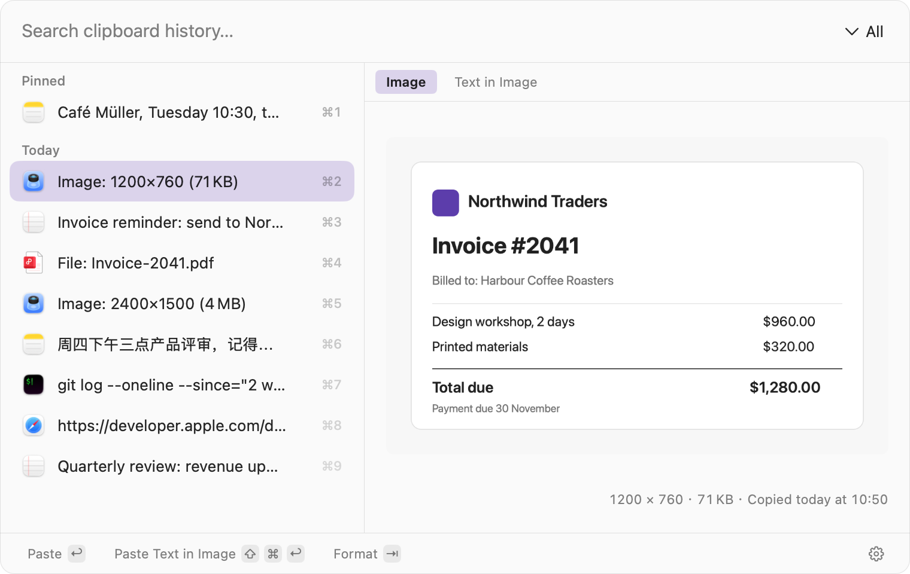
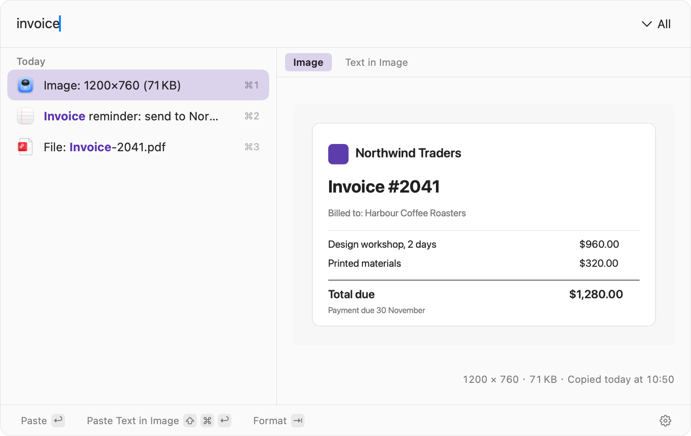
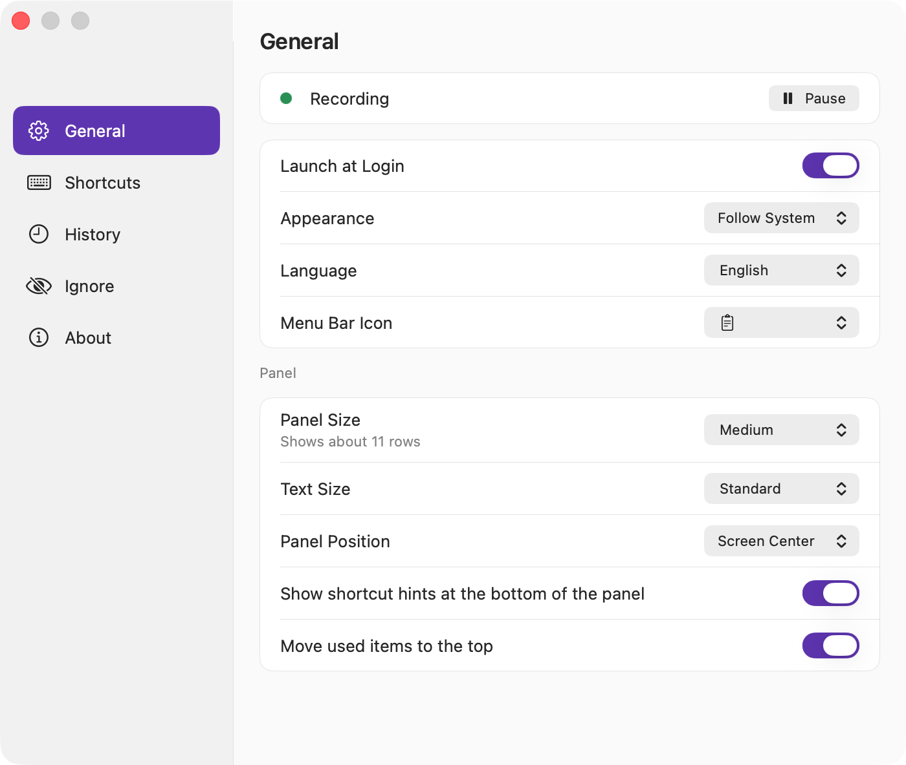

<p align="center">
  
</p>

<h1 align="center">Bowerbird</h1>

<p align="center">
  Clipboard history for macOS, in the menu bar. Keeps text, images and files, pastes them back with a keystroke, and never touches the network.
</p>

<p align="center">
  <strong>English</strong> | <a href="README.zh-CN.md">简体中文</a> | <a href="README.zh-TW.md">繁體中文</a> | <a href="README.ja.md">日本語</a> | <a href="README.es.md">Español</a> | <a href="README.fr.md">Français</a> | <a href="README.ru.md">Русский</a>
</p>

Bowerbirds collect bright objects and arrange them carefully; this one collects what you copy.



## Install

1. Download the `.dmg` from the [latest release](https://github.com/terryxc/bowerbird/releases/latest) and drag Bowerbird to Applications.
2. Open it once. The app uses a self-signed certificate, without a Developer ID signature or Apple notarization. If macOS blocks it, allow it here:

   ```
   System Settings → Privacy & Security → Open Anyway
   ```

   Or skip the prompt by running this in Terminal:

   ```sh
   xattr -d com.apple.quarantine /Applications/Bowerbird.app
   ```

Requires macOS 14 or later. Runs on Apple silicon and Intel Macs.

## Use

- Press ⇧⌘V, type to filter, press Return to paste.
- Keeps rich text, HTML, images, PDF and file references. ⇧⌘Return pastes as plain text. For a file, ⇥ switches to its path; for a screenshot with recognized text, to that text. Files are recorded by path, so the originals must remain available.
- With text recognition enabled, screenshots are searchable by recognized text, using on-device OCR. Take them with macOS’s ⌃⇧⌘4 so they land on the clipboard instead of the Desktop.
- Search ignores differences in case, accents and character width. If there are no exact matches, it tries limited typo tolerance for queries of 4–64 ASCII characters after normalization. The menu at the right of the search field narrows the list to text, images or files.
- ⌘P pins an item at the top of the history list and exempts it from automatic expiry.
- ⌘1–9 pastes that row, ⌘Return copies without pasting, ⌘⌫ deletes. The shortcuts shown here are the defaults. Change the panel-opening and action shortcuts in Settings → Shortcuts; ⌘1–9, navigation keys and Esc are fixed.



Settings also cover launch at login, appearance, language, and the panel’s size and position.



## Privacy

- No network.
- One permission: Accessibility, to press ⌘V for you. Optional; without it, copy from Bowerbird and paste manually.
- Content marked as sensitive by the source app is skipped. 1Password, Bitwarden and Keychain Access are ignored by default. Manage excluded apps and content patterns in Settings → Ignore; unmarked sensitive content from other apps may still be recorded.
- By default text and files are kept 30 days, images 7 days. Change it in Settings → History.
- Data lives in `~/Library/Application Support/Bowerbird/`.

## FAQ

See [docs/faq.md](docs/faq.md).

## Build from source

Needs full Xcode 26 or later, selected as the active developer directory. Packaging uses `actool` to compile the icon assets, and tests require XCTest; Command Line Tools alone are not enough. The disk image also needs [dmgbuild](https://github.com/dmgbuild/dmgbuild), installed below with [uv](https://docs.astral.sh/uv/).

```sh
./scripts/make-cert.sh          # once: local certificate, so the Accessibility grant survives rebuilds
./scripts/build-app.sh release  # → build/Bowerbird.app
swift test

uv tool install dmgbuild        # once, only needed for the disk image
./scripts/make-dmg.sh           # → build/Bowerbird-<version>.dmg
```

| Path | Contents |
| --- | --- |
| `Sources/BowerbirdCore/` | Storage, pasteboard parsing, OCR. No UI. |
| `Sources/Bowerbird/` | Menu bar, panel, paste, settings. |
| `Support/` | `Info.plist`, icons, one `.lproj` per language. |
| `scripts/` | Certificate, icon generation, build, dmg. |
| `docs/` | FAQ, logo, screenshots. |

Dependencies: [GRDB.swift](https://github.com/groue/GRDB.swift) and [KeyboardShortcuts](https://github.com/sindresorhus/KeyboardShortcuts), both MIT.

Third-party license notices: [THIRD_PARTY_NOTICES.md](THIRD_PARTY_NOTICES.md).

## License

MIT. See [LICENSE](LICENSE).
