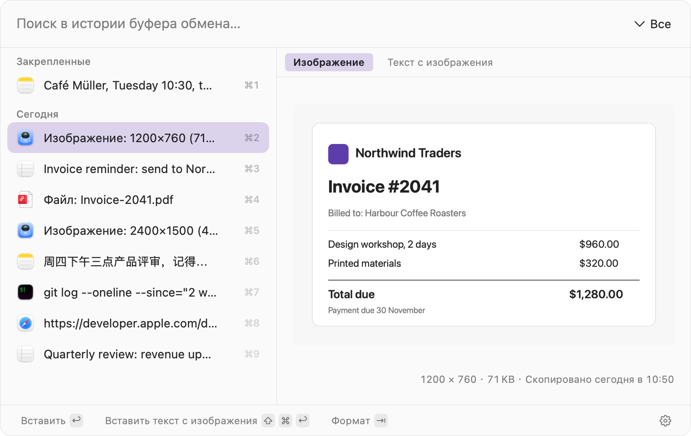
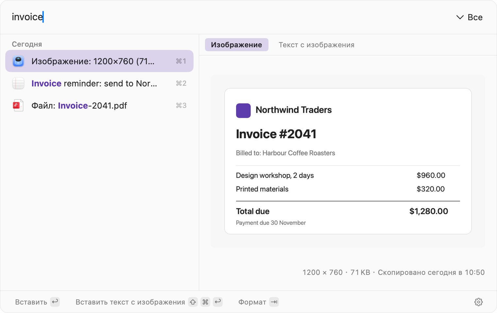
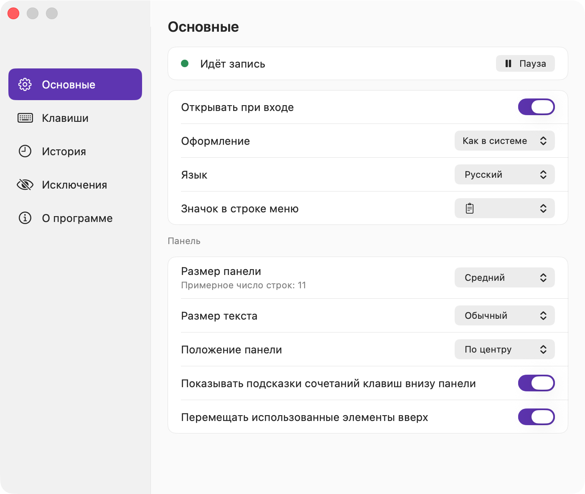

<p align="center">
  
</p>

<h1 align="center">Bowerbird</h1>

<p align="center">
  История буфера обмена для macOS в строке меню. Хранит текст, изображения и файлы, вставляет их одним нажатием и никогда не обращается к сети.
</p>

<p align="center">
  <a href="README.md">English</a> | <a href="README.zh-CN.md">简体中文</a> | <a href="README.zh-TW.md">繁體中文</a> | <a href="README.ja.md">日本語</a> | <a href="README.es.md">Español</a> | <a href="README.fr.md">Français</a> | <strong>Русский</strong>
</p>

Шалашники (bowerbirds) собирают яркие предметы и аккуратно их раскладывают; этот собирает то, что вы копируете.



## Установка

1. Скачайте `.dmg` со страницы [последнего выпуска](https://github.com/terryxc/bowerbird/releases/latest) и перетащите Bowerbird в «Программы».
2. Откройте приложение один раз. Оно использует самоподписанный сертификат, без подписи Developer ID и нотариального заверения Apple. Если macOS блокирует запуск, разрешите его здесь:

   ```
   Системные настройки → Конфиденциальность и безопасность → Всё равно открыть
   ```

   Или обойдите блокировку, выполнив в Терминале:

   ```sh
   xattr -d com.apple.quarantine /Applications/Bowerbird.app
   ```

Требуется macOS 14 или новее. Работает на Mac с Apple silicon и Intel.

## Использование

- Нажмите ⇧⌘V, введите текст для фильтрации, нажмите Return, чтобы вставить.
- Сохраняет форматированный текст, HTML, изображения, PDF и ссылки на файлы. ⇧⌘Return вставляет как обычный текст. Для файла ⇥ переключает на путь, для снимка с распознанным текстом — на этот текст. Для файлов сохраняется только путь, поэтому оригиналы должны оставаться доступными.
- При включённом распознавании текста снимки экрана можно искать по распознанным словам; обработка выполняется на самом Mac. Делайте снимки через ⌃⇧⌘4 macOS, чтобы они попадали в буфер обмена, а не на рабочий стол.
- Поиск не учитывает различия в регистре, диакритике и ширине символов. Если точных совпадений нет, допускаются небольшие опечатки в запросах из 4–64 символов ASCII после нормализации. Меню справа от поля поиска оставляет в списке только текст, изображения или файлы.
- ⌘P закрепляет элемент вверху истории и исключает его из автоматической очистки по сроку хранения.
- ⌘1–9 вставляет эту строку, ⌘Return копирует без вставки, ⌘⌫ удаляет. Здесь указаны сочетания по умолчанию. Сочетание для открытия панели и сочетания её действий меняются в «Настройки → Клавиши»; ⌘1–9, клавиши навигации и Esc изменить нельзя.



В настройках также задаются запуск при входе, оформление, язык, размер и положение панели.



## Конфиденциальность

- Никакой сети.
- Одно разрешение: «Универсальный доступ», чтобы нажимать ⌘V за вас. Необязательно; без него копируйте из Bowerbird и вставляйте вручную.
- Содержимое, помеченное исходным приложением как конфиденциальное, не записывается. По умолчанию исключены 1Password, Bitwarden и «Связка ключей». Управляйте исключёнными приложениями и шаблонами содержимого в «Настройки → Исключения»; непомеченные конфиденциальные данные из других приложений могут попасть в историю.
- По умолчанию текст и файлы хранятся 30 дней, изображения 7 дней. Это меняется в «Настройки → История».
- Данные лежат в `~/Library/Application Support/Bowerbird/`.

## Вопросы и ответы

См. [docs/faq.ru.md](docs/faq.ru.md).

## Сборка из исходников

Нужна полная версия Xcode 26 или новее, выбранная в качестве активного каталога разработчика. При упаковке `actool` компилирует ресурсы значка, а тестам нужен XCTest; одних Command Line Tools недостаточно. Для образа диска нужен ещё [dmgbuild](https://github.com/dmgbuild/dmgbuild), ниже он ставится через [uv](https://docs.astral.sh/uv/).

```sh
./scripts/make-cert.sh          # один раз: локальный сертификат, чтобы доступ не терялся при пересборке
./scripts/build-app.sh release  # → build/Bowerbird.app
swift test

uv tool install dmgbuild        # один раз, нужно только для образа диска
./scripts/make-dmg.sh           # → build/Bowerbird-<version>.dmg
```

| Путь | Содержимое |
| --- | --- |
| `Sources/BowerbirdCore/` | Хранение, разбор буфера обмена, OCR. Без интерфейса. |
| `Sources/Bowerbird/` | Строка меню, панель, вставка, настройки. |
| `Support/` | `Info.plist`, значки, по одному `.lproj` на язык. |
| `scripts/` | Сертификат, создание значка, сборка, dmg. |
| `docs/` | Вопросы и ответы, логотип, снимки экрана. |

Зависимости: [GRDB.swift](https://github.com/groue/GRDB.swift) и [KeyboardShortcuts](https://github.com/sindresorhus/KeyboardShortcuts), обе под лицензией MIT.

Лицензии сторонних библиотек: [THIRD_PARTY_NOTICES.md](THIRD_PARTY_NOTICES.md).

## Лицензия

MIT. См. [LICENSE](LICENSE).
