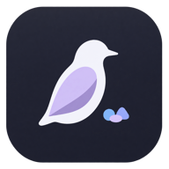
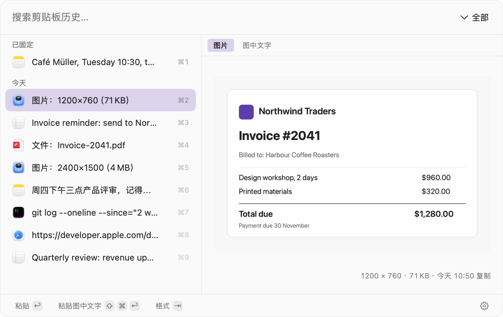
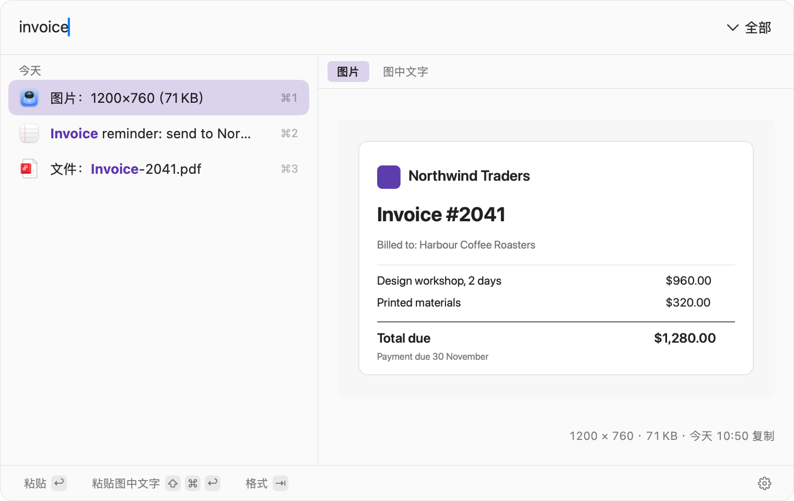
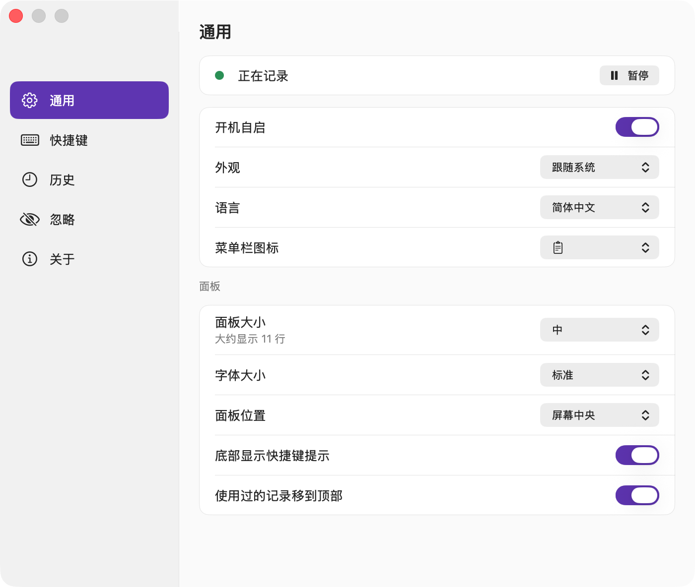

<p align="center">
  
</p>

<h1 align="center">Bowerbird</h1>

<p align="center">
  macOS 菜单栏剪贴板历史工具。记录文字、图片和文件，一个快捷键粘回去，不联网。
</p>

<p align="center">
  <a href="README.md">English</a> | <strong>简体中文</strong> | <a href="README.zh-TW.md">繁體中文</a> | <a href="README.ja.md">日本語</a> | <a href="README.es.md">Español</a> | <a href="README.fr.md">Français</a> | <a href="README.ru.md">Русский</a>
</p>

园丁鸟（bowerbird）会收集亮眼的小物件并仔细摆放；这个应用收集的是你复制过的东西。



## 安装

1. 从 [最新 Release](https://github.com/terryxc/bowerbird/releases/latest) 下载 `.dmg`，把 Bowerbird 拖进「应用程序」。
2. 先打开一次。应用使用自签名证书，尚无 Developer ID 签名，也未经过 Apple 公证。如果系统拦截，可在这里允许打开：

   ```
   系统设置 → 隐私与安全性 → 仍要打开
   ```

   或者在终端执行下面这行，直接跳过拦截：

   ```sh
   xattr -d com.apple.quarantine /Applications/Bowerbird.app
   ```

需要 macOS 14 或更高版本，Apple 芯片和 Intel 芯片的 Mac 都能用。

## 使用

- 按 ⇧⌘V，输入关键词筛选，回车粘贴。
- 保留富文本、HTML、图片、PDF 和文件引用。⇧⌘ 回车按纯文本粘贴。文件按 ⇥ 切到路径，已识别出文字的截图按 ⇥ 切到图中文字。文件只记录路径，原文件需要保持可访问。
- 开启文字识别后，可以按识别出的文字搜索截图，识别在本机完成。用系统的 ⌃⇧⌘4 截图，截图会进剪贴板而不是存到桌面。
- 搜索不分大小写，忽略重音和全角半角的差异。没有精确匹配时，会对归一化后由 4–64 个 ASCII 字符组成的关键词尝试有限的拼写容错。搜索框右边的菜单可以只看文本、图片或文件。
- ⌘P 将条目固定到历史列表顶部，固定条目不会因保留期限而被自动清理。
- ⌘1–9 直接粘贴那一行，⌘ 回车只复制不粘贴，⌘⌫ 删除。这里列出的是默认快捷键。打开面板和各项操作的快捷键可在「设置 → 快捷键」里改；⌘1–9、导航键和 Esc 不可修改。



设置里还能调登录时启动、外观、语言，以及面板的大小和位置。



## 隐私

- 不联网。
- 只要一个权限：辅助功能，用来替你按 ⌘V。可以不给，此时从 Bowerbird 复制后手动粘贴。
- 跳过来源应用标记为敏感的内容，默认忽略 1Password、Bitwarden 和钥匙串访问。可在「设置 → 忽略」里管理应用和内容规则；其他应用中未标记的敏感内容仍可能被记录。
- 默认文字和文件保留 30 天，图片 7 天，可在「设置 → 历史」里改。
- 数据在 `~/Library/Application Support/Bowerbird/`。

## 常见问题

见 [docs/faq.zh-CN.md](docs/faq.zh-CN.md)。

## 从源码构建

需要完整的 Xcode 26 或更高版本，并将其设为当前使用的开发者目录。打包用 `actool` 编译图标资源，测试需要 XCTest；只装命令行工具不够。打包 dmg 还需要 [dmgbuild](https://github.com/dmgbuild/dmgbuild)，下面用 [uv](https://docs.astral.sh/uv/) 安装。

```sh
./scripts/make-cert.sh          # 只做一次：本地证书，让辅助功能授权在重新构建后不失效
./scripts/build-app.sh release  # → build/Bowerbird.app
swift test

uv tool install dmgbuild        # 只做一次，仅打包 dmg 时需要
./scripts/make-dmg.sh           # → build/Bowerbird-<version>.dmg
```

| 路径 | 内容 |
| --- | --- |
| `Sources/BowerbirdCore/` | 存储、剪贴板解析、文字识别，无界面。 |
| `Sources/Bowerbird/` | 菜单栏、面板、粘贴、设置。 |
| `Support/` | `Info.plist`、图标、每种语言一个 `.lproj`。 |
| `scripts/` | 证书、图标生成、构建、打包 dmg。 |
| `docs/` | 常见问题、logo、截图。 |

依赖：[GRDB.swift](https://github.com/groue/GRDB.swift) 和 [KeyboardShortcuts](https://github.com/sindresorhus/KeyboardShortcuts)，都是 MIT 许可。

第三方许可声明见 [THIRD_PARTY_NOTICES.md](THIRD_PARTY_NOTICES.md)。

## 许可

MIT，见 [LICENSE](LICENSE)。
