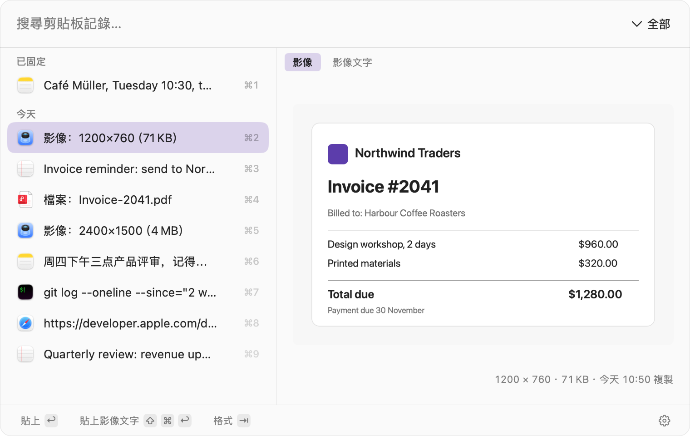
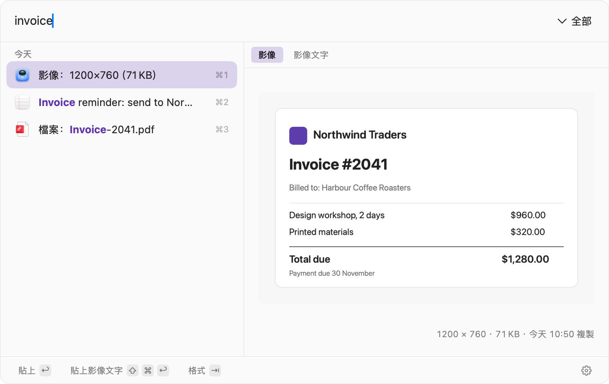
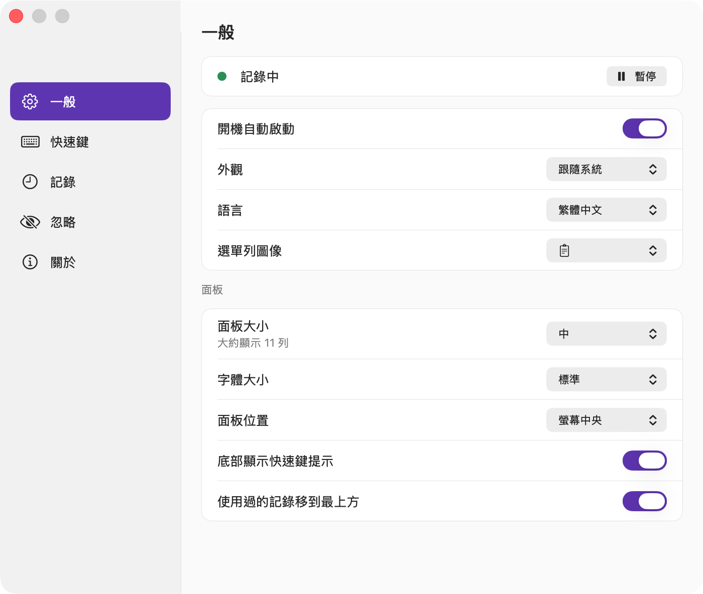

<p align="center">
  
</p>

<h1 align="center">Bowerbird</h1>

<p align="center">
  macOS 選單列剪貼板記錄工具。記錄文字、圖片和檔案，一個快速鍵貼回去，不連網。
</p>

<p align="center">
  <a href="README.md">English</a> | <a href="README.zh-CN.md">简体中文</a> | <strong>繁體中文</strong> | <a href="README.ja.md">日本語</a> | <a href="README.es.md">Español</a> | <a href="README.fr.md">Français</a> | <a href="README.ru.md">Русский</a>
</p>

園丁鳥（bowerbird）會收集亮眼的小物件並仔細擺放；這個 App 收集的是你拷貝過的東西。



## 安裝

1. 從 [最新 Release](https://github.com/terryxc/bowerbird/releases/latest) 下載 `.dmg`，把 Bowerbird 拖進「應用程式」。
2. 先打開一次。App 使用自簽憑證，尚無 Developer ID 簽章，也未經 Apple 公證。如果系統阻擋，可在這裡允許開啟：

   ```
   系統設定 → 隱私權與安全性 → 強制打開
   ```

   或者在終端機執行下面這行，直接略過攔截：

   ```sh
   xattr -d com.apple.quarantine /Applications/Bowerbird.app
   ```

需要 macOS 14 或以上版本，Apple 晶片和 Intel 晶片的 Mac 都能使用。

## 使用

- 按 ⇧⌘V，輸入關鍵字篩選，按 Return 貼上。
- 保留格式化文字、HTML、圖片、PDF 和檔案參照。⇧⌘Return 以純文字貼上。檔案按 ⇥ 切到路徑，已辨識出文字的截圖按 ⇥ 切到圖中文字。檔案只記錄路徑，原始檔案必須保持可存取。
- 啟用文字辨識後，可以用辨識出的文字搜尋截圖，辨識在本機完成。用系統的 ⌃⇧⌘4 截圖，截圖會進剪貼板而不是存到桌面。
- 搜尋不分大小寫，忽略重音與全形半形的差異。沒有精確結果時，會針對正規化後由 4–64 個 ASCII 字元組成的關鍵字嘗試有限的拼字容錯。搜尋欄右邊的選單可以只看文字、圖片或檔案。
- ⌘P 將項目固定到記錄清單頂端，固定項目不會因保留期限而被自動清除。
- ⌘1–9 直接貼上那一列，⌘ Return 只拷貝不貼上，⌘⌫ 刪除。這裡列出的是預設快速鍵。開啟面板和各項操作的快速鍵可在「設定 → 快速鍵」裡更改；⌘1–9、導覽鍵和 Esc 無法更改。



設定裡還能調整登入時啟動、外觀、語言，以及面板的大小和位置。



## 隱私

- 不連網。
- 只需要一項權限：輔助使用，用來替你按 ⌘V。可以不給，此時從 Bowerbird 拷貝後手動貼上。
- 略過來源 App 標記為敏感的內容，預設忽略 1Password、Bitwarden 和鑰匙圈存取。可在「設定 → 忽略」裡管理 App 和內容規則；其他 App 中未標記的敏感內容仍可能被記錄。
- 預設文字和檔案保留 30 天，圖片 7 天，可在「設定 → 記錄」裡更改。
- 資料位於 `~/Library/Application Support/Bowerbird/`。

## 常見問題

見 [docs/faq.zh-TW.md](docs/faq.zh-TW.md)。

## 從原始碼建置

需要完整的 Xcode 26 或以上版本，並將其設為目前使用的開發者目錄。打包使用 `actool` 編譯圖像資源，測試需要 XCTest；只裝命令列工具不夠。製作 dmg 還需要 [dmgbuild](https://github.com/dmgbuild/dmgbuild)，下面用 [uv](https://docs.astral.sh/uv/) 安裝。

```sh
./scripts/make-cert.sh          # 只做一次：本機憑證，讓輔助使用授權在重新建置後不失效
./scripts/build-app.sh release  # → build/Bowerbird.app
swift test

uv tool install dmgbuild        # 只做一次，僅製作 dmg 時需要
./scripts/make-dmg.sh           # → build/Bowerbird-<version>.dmg
```

| 路徑 | 內容 |
| --- | --- |
| `Sources/BowerbirdCore/` | 儲存、剪貼板解析、文字辨識，無介面。 |
| `Sources/Bowerbird/` | 選單列、面板、貼上、設定。 |
| `Support/` | `Info.plist`、圖像、每種語言一個 `.lproj`。 |
| `scripts/` | 憑證、圖像產生、建置、製作 dmg。 |
| `docs/` | 常見問題、logo、截圖。 |

相依套件：[GRDB.swift](https://github.com/groue/GRDB.swift) 和 [KeyboardShortcuts](https://github.com/sindresorhus/KeyboardShortcuts)，皆為 MIT 授權。

第三方授權聲明見 [THIRD_PARTY_NOTICES.md](THIRD_PARTY_NOTICES.md)。

## 授權

MIT，見 [LICENSE](LICENSE)。
